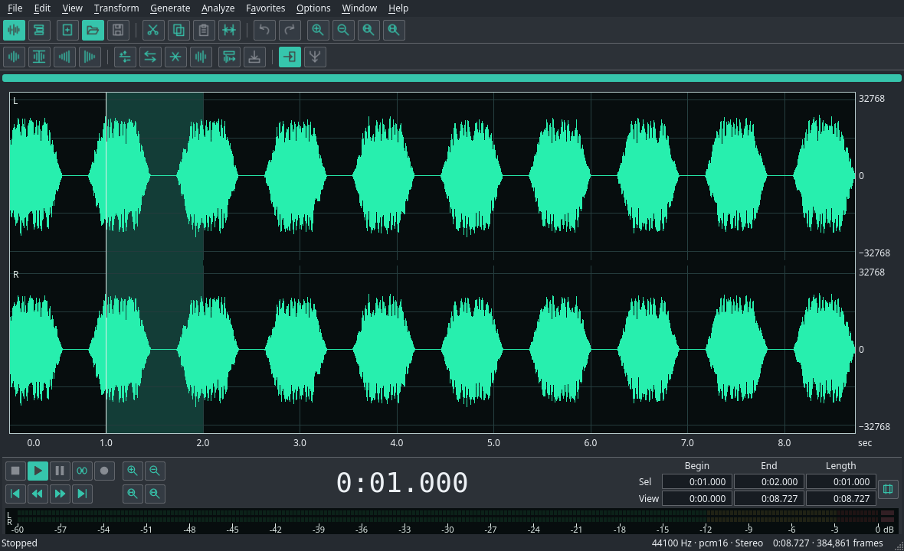

# SoundSausage


Een intuïtieve, eenvoudig te gebruiken audio-editor met alle tools op de plek waar je ze verwacht.

Bewerk losse opnamen of combineer meerdere sporen. De interface volgt je eigen Linux-thema en accentkleur.



De huidige versie is **0.14.0**.

## Wat het kan

- WAV-bestanden openen, bewerken en opslaan.
- Mono of stereo opnemen via microfoon of audio-interface, met apparaatkeuze en live meters.
- Selecteren, knippen, kopiëren, plakken, mengen en trimmen, met ongedaan maken en opnieuw.
- Links of rechts afzonderlijk selecteren en bewerken met behoud van het andere kanaal.
- Volume aanpassen, fades toepassen, normaliseren, omkeren en stilte toevoegen.
- Stereokanalen mengen, dynamiek bewerken en een volumeverloop tekenen, met luistervoorbeelden.
- Grafische en parametrische EQ, hoog-/laagdoorlaat-, banddoorlaat- en notchfilters.
- Delay, echo en galm, met presets, luistervoorbeelden en optionele uitklank.
- Ruisprofielen opnemen en bewaren, ruis verminderen en korte tikken herstellen.
- Speelduur en toonhoogte onafhankelijk aanpassen, met formantbehoud voor zang.
- Zachte of harde vervorming, wavefold en bit crush, plus convolutie met een impulsrespons.
- Meerdere sporen combineren, clips verplaatsen en trimmen, met volume, pan, mute en solo.
- Volume- en panlijnen op clips tekenen en bewerken.
- Projecten opslaan met alle gebruikte audio en een complete mix exporteren.
- Eenvoudige oudere sessies importeren.
- Inzoomen op de golfvorm, afspelen in een lus en frequenties analyseren.

Realtime spooreffecten, gelijktijdig opnemen en afspelen en volledige ondersteuning voor oude sessies volgen later.
Zie [status en beperkingen](docs/STATUS.md).

## Installeren en starten

Benodigd: Python 3.12–3.14, een C++20-compiler, Make, Qt Multimedia, libsamplerate en Rubber Band (3.3 of nieuwer).
Op Arch is Qt Multimedia een aparte afhankelijkheid naast PySide6.

Installatiepakketten voor Debian/Ubuntu, Fedora en Arch staan bij de
[releases](https://github.com/rene-timmermans/SoundSausage/releases).
Zie [installeren](docs/INSTALLEREN.md) voor ondersteunde versies en installatiecommando's.
Handmatig bouwen vanuit de broncode:

```bash
git clone https://github.com/rene-timmermans/SoundSausage.git
cd SoundSausage
python3 -m venv .venv
source .venv/bin/activate
python3 -m pip install -r requirements.txt
./run.sh
```

Het startscript bouwt de audiokern automatisch. Voorbeeldprojecten staan in [examples](examples/).

## Bediening

Wissel met **Tab** tussen golfvorm en multitrack. **Spatie** start en stopt het afspelen.
**Ctrl+W** sluit de huidige golfvorm of sessie; het programma blijft open. Bij niet-opgeslagen wijzigingen kun je opslaan, verwerpen of annuleren.
In multitrack sleep je WAV-bestanden op een spoor en verplaats of trim je clips met de muis.
Met **Volume Line** en **Pan Line** teken je de lijnen op een clip.

De effecten staan onder **Transform**; versterken en normaliseren vind je in **Amplitude**.
Daar staan ook **Channel Mixer**, **Dynamics Processing** en **Envelope**.
Effecten bewerken het gekozen tijdvak en de gekozen kanalen. Sleep in één golf voor links
of rechts, of over beide golven voor stereo. De keuze staat ook boven de golfvorm.
Zie [kanaalselectie en zoomen](docs/KANAALSELECTIE.md).
Met **Preview** beluister je de instelling voordat je die toepast. Zie [Amplitude](docs/AMPLITUDE.md).
Onder **Filters** staan de grafische en parametrische EQ en de filters, met presets
en een grafiek van de gezamenlijke frequentierespons. Zie [EQ en filters](docs/FILTERS.md).
Onder **Delay Effects** staan Delay, Echo en Reverb. Met **Add effect tail**
bewaar je ook de uitklank. Zie [delay, echo en galm](docs/DELAY_GALM.md).
Onder de tijdlijn staan het transport, de grote klok, selectie- en weergavetijden en de stereometer.
Met **R** of de opnameknop kies je een ingang en bestemming. **Stop**, **Esc** of **Spatie** bewaart de take; **P** pauzeert/hervat. Zie de handleiding voor het verschil tussen stoppen en verwerpen.
Met **Options → Show Toolbar Labels** toon je namen naast de werkbalkiconen. **F11** wisselt naar schermvullende weergave.
Via **Options → Audio Hardware** kies je het uitvoerapparaat. Verschillende samplerates
worden bij import en plakken omgezet; **Edit → Convert Sample Rate** zet een golfvorm om.
Zie [audio-instellingen](docs/AUDIO.md) en de [ontwikkelvoortgang](docs/VOORTGANG.md).

Meer uitleg: [volume- en panlijnen](docs/ENVELOPES.md) en [thema](docs/THEMA.md).
De [volledige handleiding](docs/HANDLEIDING.md) staat ook onder **Help → Handleiding**
en **F1**, met een zoekfunctie en uitleg van alle beschikbare effecten en functies.

## Wat er nieuw is

**0.14.0** Links en rechts afzonderlijk selecteren en bewerken, met kanaalkeuze, luistervoorbeelden en Undo/Redo. Doorlopende golfvorm bij zoomen, verschillende zoomiconen en eigen iconen voor de menufuncties.

**0.13.0** Vier vervormingsvormen met presets, menging en optionele oversampling. Convolutie met WAV-impulsresponsen en optionele uitklank. Zie [vervorming en convolutie](docs/VERVORMING_CONVOLUTIE.md).

**0.12.0** Stretch past de lengte aan met behoud van toonhoogte; Pitch Shift verschuift de toonhoogte met behoud van lengte. Met tempoverhouding, kwaliteitskeuze en optioneel formantbehoud. Zie [tijd en toonhoogte](docs/TIJD_TOONHOOGTE.md).

**0.11.0** Ruisprofielen opnemen, bewaren en opnieuw gebruiken. Ruisreductie met stereokoppeling en een luistervoorbeeld van het verwijderde geluid, plus herstel van korte tikken. Zie [restauratie](docs/RESTORATIE.md).

**0.10.0** Delay met tijden per kanaal, Echo met demping en stereopingpong en Reverb met ruimtegrootte, nagalmtijd, voorvertraging en stereobreedte. Met presets, luistervoorbeelden en een optionele uitklank die de opname verlengt.

**0.9.0** Grafische EQ met tien banden, parametrische EQ met vijf bell-banden en low/high shelf, plus hoogdoorlaat-, laagdoorlaat-, banddoorlaat- en notchfilters. Met frequentiegrafieken, presets, luistervoorbeelden en uitgangsvolume.

**0.8.0** Mono- en stereo-opname naar een nieuwe golfvorm, de huidige golfvorm of een spoor. Live golfvorm en niveaus, pauzeren, veilig stoppen en herstel van onderbroken opnamen. Stop houdt de afspeelcursor vast. Zie [opnemen](docs/OPNEMEN.md).

**0.7.0** Lange opnamen met opslag en verwerking in blokken, voortgang en annuleren, herstel na onverwacht afsluiten en behoud van WAV-bestandsinformatie. Zie [lange bestanden en herstel](docs/LANGE_BESTANDEN.md).

**0.6.1** Een volledige Nederlandstalige handleiding in het helpmenu, met F1 en zoeken, ook zonder internet.

**0.6.0** Geïntegreerd afspelen met apparaatkeuze en een audioklok voor cursor en meters. Samplerateconversie bij import, plakken en golfvormbewerking. Zie de [releasepunten](docs/releases/0.6.0.md).

**0.5.0** De groep Amplitude is uitgebreid met Channel Mixer, Dynamics Processing en Envelope. Alle Amplitude-dialogen hebben een luistervoorbeeld; Normalize kan DC-offset verwijderen. Installatiepakketten zijn beschikbaar voor Debian/Ubuntu, Fedora en Arch. Zie de [releasepunten](docs/releases/0.5.0.md).

**0.4.1** File → Close en Ctrl+W sluiten de huidige golfvorm of sessie, met een keuze voor niet-opgeslagen wijzigingen.

**0.4.0** Compacte werkbalken en gegroepeerde menu's, een groot werkvlak en een vaste onderrand met transport, klok, selectie-/weergavetijden en een stereometer met dB-schaal en clipindicatie.

SoundSausage is beschikbaar onder [GPL-3.0-or-later](LICENSE): GNU GPL versie 3 of, naar keuze, een latere versie.
