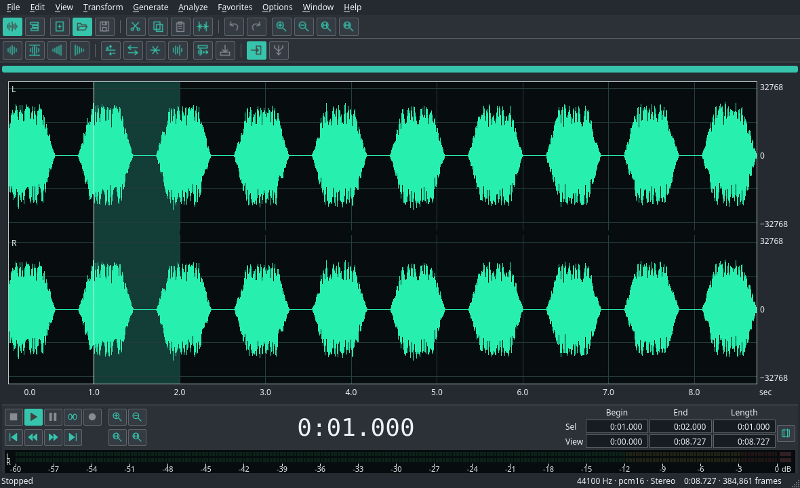

# SoundSausage

Een intuïtieve, eenvoudig te gebruiken audio-editor met alle tools op de plek waar je ze verwacht.

Bewerk losse opnamen of combineer meerdere sporen. De interface volgt je eigen Linux-thema en accentkleur.

De huidige versie is **1.3.2**.

## Wat het kan

**Werkruimte**

- Golfvormweergave voor één opname en multitrack voor meerdere sporen; wissel met **Tab** of de knoppen bovenaan.
- Verplaatsbare werkbalken met kaderloze pictogrammen: algemene knoppen en markeringen bovenaan, een aparte effectenbalk en bediening direct bij de audio.
- Directe effectknoppen en uitklapgroepen die hun laatste keuze onthouden; kies een venstereffect om meteen de instellingen te openen.
- Inzoomen tot afzonderlijke samples, afspelen in een lus en een frequentieanalyse van het gekozen fragment.
- Tijdens afspelen naar een andere plek springen door op de golfvorm of tijdliniaal te klikken.
- Transport, grote klok, selectie- en weergavetijden en een stereometer met dB-schaal en piekindicatie.
- Begin, Einde en Lengte van de selectie en het zichtbare bereik rechtstreeks instellen met tijdinvoer.
- Lichte en donkere Linux-thema's, de accentkleur van het bureaublad en vensters die met taal en lettergrootte meegroeien.

**Opnemen en bewerken**

- Een nieuwe mono- of stereogolfvorm maken met instelbare duur en samplerate, met stilte als begininhoud.
- Mono of stereo opnemen via een microfoon of audio-interface, met keuze van ingang en uitgang, live golfvorm en niveaus.
- Systeemgeluid opnemen van de standaarduitgang, bijvoorbeeld muziek uit een browser, met Systeemgeluid (wat je hoort).
- Opnemen naar een nieuwe golfvorm, invoegen bij de cursor, een selectie vervangen of een nieuwe clip op een spoor maken.
- Pauzeren, hervatten en een take in één stap ongedaan maken; een kort opnamebegin overslaan om inschakeltikjes te vermijden.
- Selecteren, knippen, kopiëren, plakken, mengen en trimmen, met ongedaan maken en opnieuw.
- Links en rechts afzonderlijk knippen, plakken, tijdrekken en opnemen; het andere kanaal blijft op zijn plaats.
- Samplepunten verslepen of hun waarde exact invoeren om kleine tikjes plaatselijk te corrigeren.
- Met D rechtstreeks op de golfvorm tekenen, ook bij minder vergroting, met één stap ongedaan maken.

- Markeringen toevoegen, benoemen, verplaatsen en bezoeken, met een markeringenlijst en behoud bij opslaan.

**Effecten en geluid**

- Remaster vermindert het wegzakken van stemmen en instrumenten bij sterke drums, met vergelijking op gelijk luistervolume en apart herstel voor korte volumedalingen.
- Versterken, fades, normaliseren en ompolen; kanaalmixer, dynamiekbewerking en een bewerkbaar volumeverloop.
- Grafische en parametrische EQ, hoog- en laagdoorlaat, banddoorlaat en notchfilters, met frequentiegrafieken.
- Delay, echo en galm, met presets, luistervoorbeelden en optionele uitklank.
- Ruisprofielen leren en bewaren, vaste of wisselende achtergrondruis verminderen met instelbaar detailbehoud, en korte tikken herstellen.
- Speelduur en toonhoogte onafhankelijk aanpassen, met formantbehoud voor zang.
- Soft clip, hard clip, wavefold en bit crush; convolutie met een impulsrespons.
- Effectinstellingen beluisteren voordat je ze toepast en bewerkingen ongedaan maken.

**Multitrack en plug-ins**

- Tot 32 sporen combineren; clips verplaatsen, trimmen en dupliceren, met volume, pan, mute en solo.
- Volume- en panlijnen tekenen op clips en realtime spoorketens bewerken, met volgorde, bypass en uitklank.
- Native Linux VST3-, LV2- en LADSPA-effecten gebruiken, met eigen plug-invensters waar ondersteund.
- Plug-ininstellingen in het project bewaren en gerapporteerde plug-invertraging automatisch compenseren bij afspelen en eindmix.
- Andere sporen beluisteren tijdens opnemen, met samen pauzeren en stoppen, opnamekalibratie en automatische klokdriftcorrectie.
- Punch-in/out: een passage opnieuw opnemen met voorloop en korte overgangen, met behoud van de oorspronkelijke audio.

**Bestanden en herstel**

- WAV en MP3 openen, bewerken en opslaan; kiezen tussen WAV en MP3 voor selectie-export en eindmix.
- Bestandsinformatie bewaren, waaronder ondersteunde WAV-labels en cuepunten en MP3-tekst en hoesafbeeldingen. Hoofdstukken volgen audiobewerkingen; verouderde MP3-meetgegevens vervallen.
- Projecten bewaren met de gebruikte audio, clips, lijnen en effecten; na heropenen blijven de sporen afzonderlijk bewerkbaar.
- Lange opnamen bewerken met opslag op schijf, voortgang en annuleren, en werk herstellen na onverwacht afsluiten.

**Hulp**

- Een volledige, doorzoekbare handleiding in vijf talen via **Help → Handleiding** en **F1**, ook zonder internet.
- Uitleg van alle beschikbare functies en effecten, hun instellingen en praktische voorbeelden.

Lees de [handleiding](docs/HANDLEIDING.md) voor de bediening en praktische uitleg.

## Installeren

Download het pakket voor jouw distributie bij de nieuwste
[release](https://github.com/rene-timmermans/SoundSausage/releases/latest).
De pakketbeheerder installeert de benodigde onderdelen automatisch mee; een compiler is niet nodig.
Daarna staat SoundSausage in het toepassingenmenu, of start je het met `soundsausage`.

Voer het installatiecommando uit in de downloadmap en vervang `<versie>` door het versienummer op het pakket.

| Distributie | Installeren | Verwijderen |
|---|---|---|
| Arch Linux | `sudo pacman -U ./soundsausage-<versie>-1-x86_64.pkg.tar.zst` | `sudo pacman -R soundsausage` |
| Debian 13, Ubuntu 26.04 of nieuwer | `sudo apt install ./soundsausage_<versie>-1_amd64.deb` | `sudo apt remove soundsausage` |
| Fedora | `sudo dnf install ./soundsausage-<versie>-1.*.x86_64.rpm` | `sudo dnf remove soundsausage` |

De pakketten zijn voor **x86-64 / amd64** en worden bij iedere release gebouwd, geïnstalleerd en getest.
Ubuntu 24.04 en Debian 12 worden niet ondersteund. Op Ubuntu moet de universe-pakketbron ingeschakeld zijn.
Zie [installeren](docs/INSTALLEREN.md) voor meer uitleg en bouwen vanuit de broncode.

## Taal

SoundSausage is er in het Nederlands, Engels, Duits, Frans en Spaans.
Kies een andere taal via **Opties → Taal**. Menu's, vensters en de geopende handleiding veranderen direct mee;
de keuze blijft bij de volgende start bewaard. De volledige handleidingen zijn ook rechtstreeks te lezen:
[Nederlands](docs/HANDLEIDING.md), [English](docs/manual/en.md), [Deutsch](docs/manual/de.md),
[Français](docs/manual/fr.md) en [Español](docs/manual/es.md).

## Wat er nieuw is

**[1.3.2](https://github.com/rene-timmermans/SoundSausage/releases/tag/v1.3.2)** Compactere programma-iconen, een overzichtelijk changelog en lokaal te genereren voorbeeldprojecten.

**[1.3.1](https://github.com/rene-timmermans/SoundSausage/releases/tag/v1.3.1)** Remaster onderscheidt korte volumedalingen beter van noot- en klankwisselingen, zodat stille restgeluiden niet onnodig naar voren komen.

Alle eerdere wijzigingen staan in het [changelog](CHANGELOG.md).

## Licentie

SoundSausage is vrije software onder de [GNU General Public License v3.0 of later](LICENSE).
