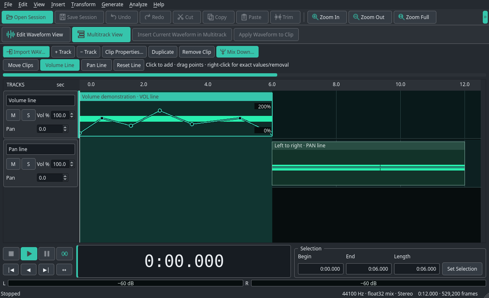

# SoundSausage


Een native golfvorm- en multitrackeditor, met bediening en uiterlijk geïnspireerd op de aangeleverde Cool Edit Pro-build en GUI-afbeelding. De interface gebruikt Qt 6; audiobewerkingen en het mengen van sporen draaien in een C++20-kern.



Prototype 0.3.0 kan WAV bewerken en meerdere sporen mengen, clips verplaatsen en trimmen, volume/pan en fades toepassen, volume- en panlijnen op clips tekenen, undo/redo uitvoeren en zelfstandige projecten opslaan. De bediening volgt je Linux-thema en accentkleur, met leesbare teksten en belangrijke knoppen in de accentkleur. De zes aangeleverde eenvoudige Cool Edit Pro 1.0-sessies kunnen worden geïmporteerd. Zie de [actuele status en beperkingen](docs/STATUS.md).

Het oorspronkelijke Cool Edit Pro werkt volgens de gebruiker niet op de Steam Deck. De Linux-versie wordt zelfstandig ontwikkeld. De gebruiker heeft inmiddels een Windows 7-VM gebruikt om referentiesessies te maken; die helpen de afzonderlijke oude-projectimport te onderzoeken.

**Installeren en starten op Linux**

Benodigd: Python 3.12–3.14, een C++20-compiler, Make en `ffplay` (uit FFmpeg). De geteste Python-afhankelijkheden staan in `requirements.txt`.

```bash
git clone https://github.com/rene-timmermans/SoundSausage.git
cd SoundSausage
python3 -m venv .venv
source .venv/bin/activate
python3 -m pip install -r requirements.txt
./run.sh
```

`run.sh` bouwt de kleine C++-library indien nodig en start de desktopinterface. Het startscript installeert geen pakketten en past geen systeeminstellingen aan. De broncode en tests gebruiken de Python-package `soundsausage`.

Met zelf gegenereerde voorbeeldaudio:

```bash
make demo
./run.sh build/demo.wav
```

Met een multitrackdemo, of een aangeleverde referentiesessie:

```bash
./run.sh build/demo-multitrack.celp
./run.sh reference/vm-session-test/02-basis.ses
```

Sluit een oudere prototypeversie en start opnieuw om de nieuwe interface te gebruiken. Bekijk de huidige [donkere golfvormweergave](docs/screenshots/theme-previews/dark-teal-waveform.png), [lichte golfvormweergave](docs/screenshots/theme-previews/light-purple-waveform.png) en [multitrackweergave](docs/screenshots/theme-previews/dark-teal-multitrack.png). Dit zijn echte Qt-screenshots met voorbeeldpaletten; het programma gebruikt je eigen Qt-desktoppalet. Zie [thema en leesbaarheid](docs/THEMA.md).

**Multitrack gebruiken**

Kies bovenaan **Multitrack View**. Importeer WAV's met **Import WAV…**, of stuur de huidige golfvorm naar een spoor met **Insert Current Waveform in Multitrack**. Je kunt ook WAV-bestanden vanuit de bestandsbeheerder op een spoor slepen.

- Sleep een clip om hem in de tijd of naar een ander spoor te verplaatsen. Sleep de rand om te trimmen.
- Gebruik links de spoorvelden voor volume/pan en **M**/**S** voor mute/solo.
- **Clip Properties…** stelt bronbereik, positie, clipvolume/pan en fades in.
- **Volume Line** en **Pan Line** laten je punten toevoegen en verslepen. Rechtsklik bij een punt voor exacte waarden of verwijderen. **Reset Line** maakt de gekozen lijn neutraal; **Move Clips** kiest het gewone slepen/trimmen. Punten werken door in afspelen en mixdown, en blijven bewaard in het project.
- Dubbelklik opent een golfvormkopie. **Apply Waveform to Clip** zet de bewerking terug in die clip, met undo.
- **Ctrl+S** bewaart in deze modus de sessie als `.celp`, met ingebedde audio. **Mix Down Session…** exporteert de hele sessie als WAV.

Open oude `.ses`-bestanden via **File → Open Session…**. Als de bron-WAV's ontbreken kun je een map aanwijzen. Opslaan gebeurt daarna als `.celp`; het origineel wordt niet overschreven. De importer is beperkt tot de onderzochte Pro 1.0-indeling en ondersteunt nog geen automation of cues. Zie [SES-onderzoek](docs/SES-ONDERZOEK.md).

Probeer de ingebedde demo met volume- en panlijnen:

```bash
PYTHONPATH=src python3 tools/make_envelope_demo.py
./run.sh build/demo-envelopes.celp
```

Druk op Spatie: eerst hoor je zes seconden volumevariatie, daarna een toon die van links naar rechts beweegt. Zie [de bediening en voorbeelden](docs/ENVELOPES.md). Nieuwe projecten gebruiken CELP versie 2; oudere versie-1-projecten blijven te openen.

De [screenshot van het prototype](docs/screenshots/prototype.png) is uit het echte Qt-venster gerenderd. De demo is synthetisch; de lege oorspronkelijke voorbeeldbestanden worden niet gebruikt.

**Bediening**

| Actie | Bediening |
| --- | --- |
| Openen / opslaan | Ctrl+O / Ctrl+S; Ctrl+Shift+S voor Save As |
| Werkmodus wisselen | Tab, of de knoppen Edit Waveform View / Multitrack View |
| Sessies | Ctrl+Alt+N nieuw; Ctrl+Alt+O openen; Ctrl+Alt+S opslaan |
| Clip dupliceren | Ctrl+D in multitrackweergave |
| Selectie | Slepen in de golfvorm; Edit → Set Selection voor exacte framegrenzen |
| Hele golfvorm selecteren | Ctrl+A |
| Knippen / kopiëren / plakken | Ctrl+X / Ctrl+C / Ctrl+V |
| Mix Paste / trimmen | Ctrl+M / Ctrl+T |
| Verwijderen | Delete |
| Undo / redo | Ctrl+Z / Ctrl+Shift+Z |
| Laatste effect herhalen | F2 |
| Zero crossings naar binnen | F4; eerste kanaal als referentie |
| Zoomen | + / −; Ctrl+0 voor volledig; Ctrl+Shift+A voor selectie |
| Zoomen en scrollen met muis | Ctrl+scrollwiel om te zoomen; scrollwiel om te schuiven |
| Afspelen / stoppen | Spatie; Esc stopt; P pauzeert/hervat |
| Frequentieanalyse | Alt+Z |

Effecten zonder selectie werken op de hele golfvorm. Selecties gebruiken intern framegrenzen met een exclusief einde. Bij standaard plakken wordt de selectie vervangen; zonder selectie wordt vanaf de cursor ingevoegd. Het interne klembord vereist dezelfde samplerate en hetzelfde kanaalaantal. Afspelen gebruikt ffplay; de gebruiker heeft bevestigd dat geluid op het doelapparaat werkt.

**Bouwen en testen**

```bash
make
make test
```

De 111 tests controleren audio-I/O, de C++-effecten en mixer, automation, projectbestanden, de echte SES-referenties, GUI-acties, live themawisselingen en streaming naar ffplay met een dummy-audioapparaat. Drie PCM16-mixdowns zijn [vergeleken met originele VM-exports](docs/SES-ONDERZOEK.md): alle gemeenschappelijke audiobytes zijn exact gelijk; de originele exports hebben elk één extra stil frame. Versie 0.2.1 past daarvoor de begrenzing bij 16-bit sessie-mixdown aan. De [actuele testuitvoer](docs/validation/test-results-soundsausage.log) is bewaard. Een reproduceerbare screenshot zonder audiotoegang:

```bash
./run.sh build/demo.wav --no-audio --screenshot build/prototype.png
```

**Projectindeling**

| Map | Inhoud |
| --- | --- |
| `native/` | C++20-DSP en de C-interface |
| `src/soundsausage/` | Documentmodel, WAV-I/O, Qt-interface en afspeeladapter |
| `tests/` | Functionele audio-, GUI- en integratietests |
| `tools/` | Demo-audiogeneratoren, automation- en thema-previews, SES-inspectie en vergelijking met originele mixdowns |
| `build/` | Gecompileerde library, demo, screenshot en testlog |
| `docs/` | Huidige implementatiestatus |
| `examples/` | Direct te openen multitrack- en automationdemo's met ingebedde synthetische audio |
| `analysis/` | REA-onderzoek, bewijs, UI-specificatie en bouwplan |
| `reference/vm-session-test/` | Gegenereerde test-WAV's, ongewijzigde SES-referenties en drie originele mixdowns uit de VM |

Het [onderzoeksrapport](analysis/ANALYSE.md) onderscheidt de rechtstreeks waargenomen eigenschappen van gevolgtrekkingen en onbekenden. Het [bouwplan](analysis/BOUWPLAN.md) beschrijft de volledige beoogde functieomvang. De Windows-bestanden zijn alleen onderzoeksreferenties en worden niet door het prototype geladen.

Referentiebronnen: `/home/deck/CoolEdit/` en `/home/deck/.wine/drive_c/coolpro/`. Bouwen en testen gebeurt binnen deze projectmap.

De documentatie bevat bewaarde screenshots en testuitvoer in `docs/screenshots/` en `docs/validation/`. Nieuw gegenereerde uitvoer blijft in `build/`. De onderzoeksbundel bevat analysegegevens; de oorspronkelijke Windows-programmabestanden worden niet meegeleverd. De naam SoundSausage wordt voor het zelfstandige Linux-project gebruikt; verwijzingen naar Cool Edit Pro beschrijven uitsluitend het onderzochte origineel.
