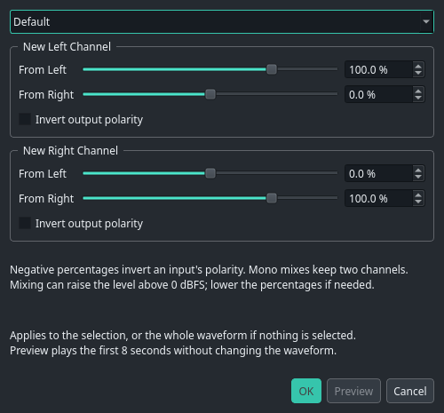
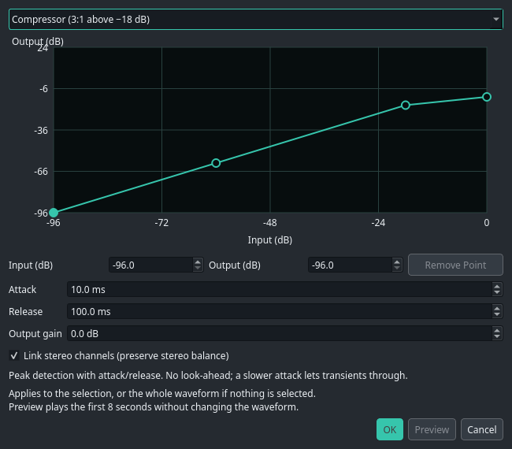
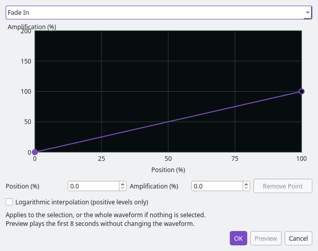

# Amplitude

Onder **Transform → Amplitude** staan versterking, kanaalmenging, dynamiek,
volumeverloop en normalisatie. Selecteer een fragment om alleen dat deel te
bewerken. Zonder selectie werkt een effect op de hele golfvorm.

**Preview** speelt de eerste acht seconden van het resultaat zonder iets te
wijzigen. Nogmaals klikken stopt het voorbeeld. Een instelling wijzigen of het
venster sluiten stopt het ook. **OK** past het effect toe; **Cancel** laat de
golfvorm ongewijzigd. **Ctrl+Z** maakt een toepassing ongedaan. **F2** herhaalt
het laatste effect met dezelfde instellingen op de nieuwe selectie.

Luistervoorbeelden gebruiken dezelfde uitgang als normaal afspelen. Kies die
onder **Options → Audio Hardware**; een apparaatwijziging stopt lopende voorbeelden.

## Amplify / Fade

Stel de begin- en eindversterking per kanaal in. 100% houdt het volume gelijk;
50% halveert de amplitude. Koppel links/rechts voor een gelijk volumeverloop.
Lineaire fades kunnen naar stilte lopen; logaritmische fades vereisen positieve
eindwaarden. Fade In en Fade Out zijn ook direct vanuit het menu beschikbaar.

## Channel Mixer

Voor elk nieuw kanaal kies je hoeveel van het oorspronkelijke linker- en
rechterkanaal wordt gebruikt. De percentages lopen van −200% tot 200%.
Negatieve waarden keren de polariteit van die bijdrage om; **Invert output
polarity** keert het complete nieuwe kanaal om.

Presets wisselen links/rechts, middelen beide kanalen naar mono, kopiëren één
kanaal naar beide kanten of maken het verschil tussen links en rechts.
Een mono-mix blijft een stereobestand met twee gelijke kanalen. Channel Mixer
is alleen beschikbaar voor stereo.

## Dynamics Processing

De curve koppelt ingangsniveau aan uitgangsniveau, in dBFS. Klik om een punt toe
te voegen en sleep om het te verplaatsen. De velden onder de curve bieden
numerieke invoer. Rechtsklikken of **Delete** verwijdert een binnenpunt.

Presets bieden een compressor, piekbegrenzer, zachte gate en neerwaartse
expander. **Attack** en **Release** bepalen hoe snel de piekdetector reageert;
**Output gain** versterkt of verzwakt het resultaat. **Link stereo channels**
gebruikt dezelfde versterking voor beide kanalen en behoudt zo de balans.
Zonder koppeling worden de kanalen onafhankelijk geregeld.

Dit is een piekdetector zonder vooruitblik. Een tragere attack laat korte pieken
door. De begrenzerpreset gebruikt daarom een attack van nul. Onder de eerste
curvepositie blijft de versterking constant; boven de laatste positie loopt de
helling van het laatste segment door. De detector begint bij het begin van de
selectie. Deze zelfstandige uitvoering claimt geen exacte overeenkomst met
historische effectalgoritmen.

## Envelope

Teken het volumeverloop over de lengte van de selectie: 0% positie is het begin,
100% het einde. Versterking loopt van 0% (stilte) tot 200%. Beide kanalen volgen
dezelfde curve. Klik en sleep punten, bewerk ze numeriek of kies een preset.
Logaritmische interpolatie werkt alleen met positieve versterkingswaarden.

Dit effect schrijft het verloop in de golfvorm. De volume- en panlijnen op
multitrackclips blijven afzonderlijk bewerkbaar; zie [clip-lijnen](ENVELOPES.md).

## Normalize

Kies het gewenste piekniveau, maximaal 100%. Gekoppelde normalisatie behoudt de
stereobalans; zonder koppeling krijgt elk kanaal zijn eigen piekniveau.
**Remove DC offset** verwijdert eerst het gemiddelde signaalniveau per kanaal
en meet daarna de pieken. Stilte blijft stilte.

Mengen, versterken en dynamiek kunnen waarden boven 0 dBFS opleveren. De
interne audio blijft ongeclipt; normaliseer of verlaag de versterking voor
export naar PCM. Een stereo-effect op een multitrackclip bewerk je via
**Edit Copy in Waveform**, gevolgd door **Apply Waveform to Clip**.
